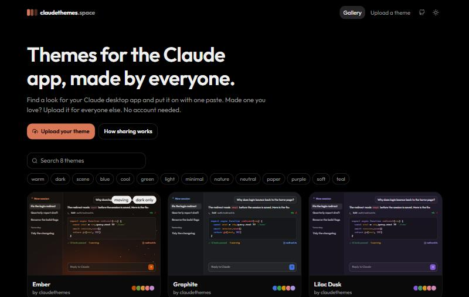
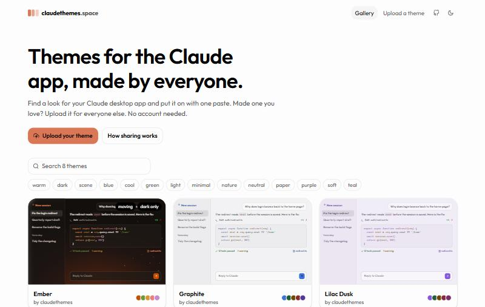
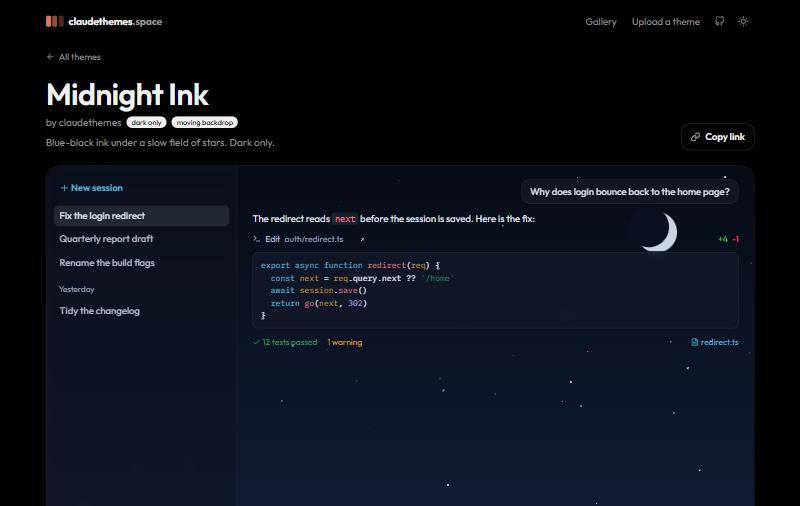
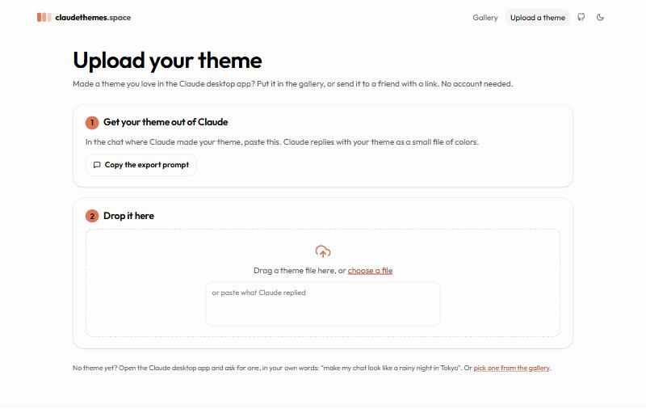
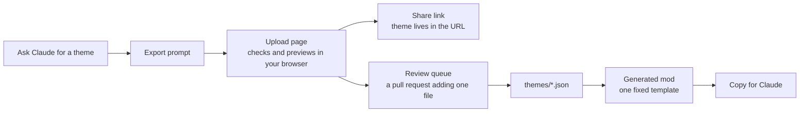

<p align="center">
  <a href="https://claudethemes.space">
    
  </a>
</p>

<p align="center">
  <a href="https://claudethemes.space"><b>Browse the gallery</b></a>
  &nbsp;·&nbsp;
  <a href="https://claudethemes.space/upload"><b>Upload your theme</b></a>
  &nbsp;·&nbsp;
  <a href="CONTRIBUTING.md"><b>Contribute</b></a>
</p>

<p align="center">
  <a href="LICENSE"></a>
  
  
  <a href="https://github.com/byalex33/claudethemes/actions"></a>
  <a href="https://github.com/byalex33/claudethemes/pulls"></a>
</p>

<br />

The Claude desktop app can wear a custom theme: its own colors, and a moving scene behind your chat. You get one by asking Claude for it. **claudethemes.space** is where those themes go to be shared.

- **Find a look.** Every theme is previewed live, in light and dark, moving backdrop included.
- **Put it on with one paste.** Copy a line, paste it into Claude, done.
- **Share yours without signing up.** Drop your theme on the upload page. Send a friend a link, or add it to the gallery.

<p align="center">
  
  
</p>

## Put a theme on

1. Open a theme on [claudethemes.space](https://claudethemes.space).
2. Press **Copy for Claude**.
3. Paste it into a chat in the Claude desktop app.

Claude installs the theme for you. To go back, ask Claude to clear the theme.

<p align="center">
  
</p>

<details>
<summary>Prefer a terminal?</summary>

<br />

```
claude plugin marketplace add byalex33/claudethemes
claude plugin install midnight-ink@claudethemes
```

</details>

## Share the theme Claude made you

1. On the [upload page](https://claudethemes.space/upload), copy the export prompt and paste it into the chat where Claude made your theme. Claude replies with your theme as a small file.
2. Drop that file on the page, or paste the reply. You get a live preview and a readability check at once.
3. Pick how to share it:
   - **Copy share link.** The whole theme lives in the link. It works straight away, and nothing is stored anywhere.
   - **Upload to the gallery.** It appears once it has been looked over.

<p align="center">
  
</p>

## Starter themes

| | Theme | Modes | Backdrop |
| --- | --- | --- | --- |
|  | [Ember](https://claudethemes.space/theme/ember) | dark | rising sparks |
|  | [Graphite](https://claudethemes.space/theme/graphite) | light, dark | |
|  | [Lilac Dusk](https://claudethemes.space/theme/lilac-dusk) | light, dark | |
|  | [Midnight Ink](https://claudethemes.space/theme/midnight-ink) | dark | star field |
|  | [Moss](https://claudethemes.space/theme/moss) | light, dark | |
|  | [Paper Notebook](https://claudethemes.space/theme/paper-notebook) | light, dark | |
|  | [Sandstone](https://claudethemes.space/theme/sandstone) | light | |
|  | [Tidepool](https://claudethemes.space/theme/tidepool) | light, dark | |

## How it works



**A theme is data, never code.**

```json
{
  "name": "Tidepool",
  "author": "claudethemes",
  "description": "Cool sea glass, with a deep-water night.",
  "tags": ["cool", "teal"],
  "roles": { "accent": "#0f7c8a", "danger": "#c0392f", "success": "#2f8a5b", "warning": "#b07a12", "pro": "#6a58b0" },
  "light": { "surface-0": "#e3eeee", "text-primary": "#12292d" },
  "dark": { "surface-0": "#0d1b1f", "text-primary": "#dcefee" },
  "scene": "<svg>an optional moving backdrop, animated with CSS only</svg>"
}
```

- **Nobody submits code.** `scripts/registry.mjs` turns each theme file into an installable Claude mod from one fixed template, so putting a theme on never runs a stranger's code.
- **Claude's own color math.** Colors go through Claude's `makeColors`, the same code the app uses. A theme Claude would refuse to paint fails the check on the upload page, in the upload endpoint and in CI alike.
- **Scenes are inert.** A backdrop is an SVG that moves with CSS alone. The checks refuse scripts, event handlers and anything loaded from outside the file, and the site only ever shows a scene through an ``.
- **No accounts, no database.** The gallery is the `themes/` folder. A share link carries its theme in the URL.

## Project layout

| Path | What it is |
| --- | --- |
| `themes/*.json` | The gallery. One file per theme. |
| `shared/core.js` | Theme checks, share links, prompts and mod generation. Used by the site, the scripts and the upload endpoint. |
| `template/hooks/make-colors.js` | Claude's theme helper, copied unchanged. Don't edit it; re-copy it when Claude updates. |
| `scripts/registry.mjs` | Checks every theme and generates `plugins/` and the marketplace file. |
| `plugins/`, `.claude-plugin/` | Generated. `.github/workflows/registry.yml` regenerates them when a theme changes. |
| `api/upload.js` | The upload endpoint, a Vercel function. |
| `src/` | The site: Vite, React, react-icons. |

## Run it locally

```
npm install
npm run dev
```

| Command | Does |
| --- | --- |
| `npm run dev` | Starts the site. |
| `npm run check` | Checks every theme. |
| `npm run registry` | Checks, then regenerates `plugins/` and the marketplace file. |
| `npm run build` | Checks, type-checks and builds to `dist/`. |

The repository name and domain live in `registry.config.json`.

## Deploy

**Site.** Hosted on Vercel, which builds and deploys every push to `main` and gives each pull request its own preview. `vercel.json` holds the build settings and the rewrite that lets `/theme/<name>` and `/upload` load directly.

**Upload endpoint.** `api/upload.js` is a Vercel function that lets people upload to the gallery with no GitHub account: it opens the review pull request for them. It switches on when the Vercel project has a `GITHUB_TOKEN` environment variable, a fine-grained token for this repository only with "Contents: write" and "Pull requests: write". Without the token, the upload button hands people to GitHub with the theme file already filled in.

## Contributing

Themes, fixes and ideas are all welcome. See [CONTRIBUTING.md](CONTRIBUTING.md).

## License

[MIT](LICENSE) for the site and scripts. Each theme belongs to its author and is shared under MIT by being uploaded here. `make-colors.js` is Anthropic's, redistributed unchanged as Claude's own instructions direct for mods.

<p align="center"><sub>A community project. Not affiliated with Anthropic.</sub></p>
